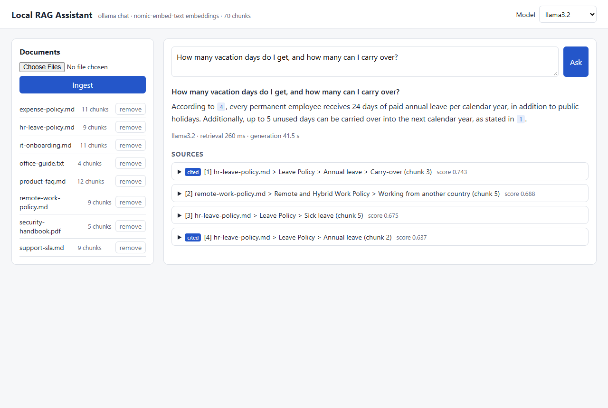
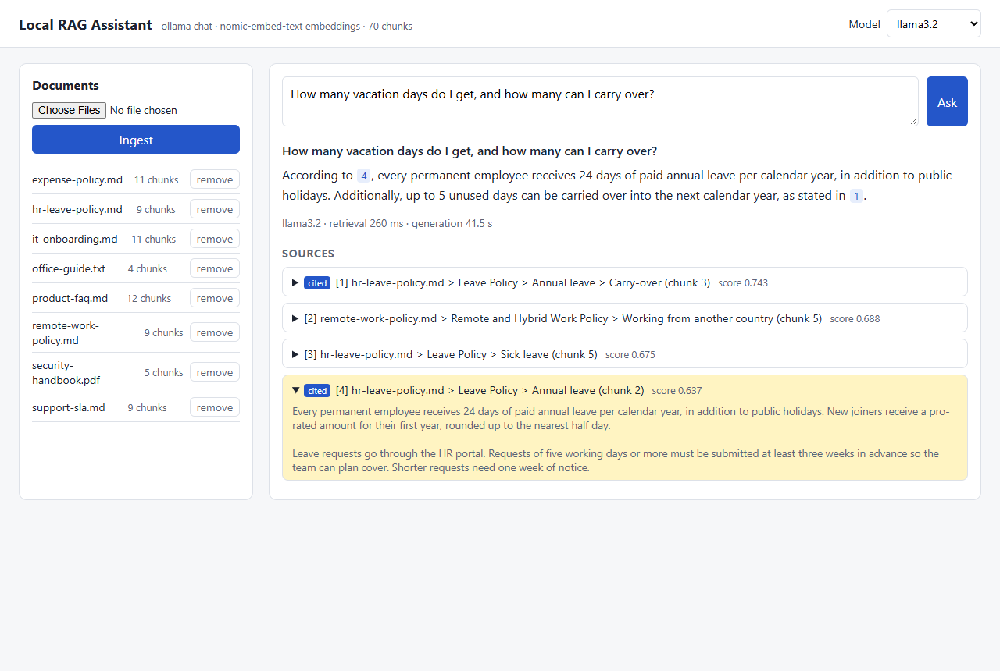
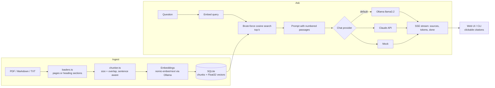

# Local RAG Assistant

Ask questions about your own PDF, Markdown and text files and get streamed answers with numbered citations, using a local model through Ollama.

[](https://github.com/sahil-ambekarr/local-rag-assistant/actions/workflows/ci.yml)
[](LICENSE)

-222)



Clicking a citation opens the passage it points to:



Both screenshots were captured with Playwright (`npm run screenshots`) from the running app, answering with `llama3.2` through a local, CPU-only Ollama.

## The problem it automates

Policies, handbooks and product FAQs are spread across many files, and finding one specific rule ("how many leave days carry over?") means opening documents and searching by hand. Keyword search misses paraphrases, and a general chatbot either does not know your documents or answers without showing where the answer came from.

This app indexes your files locally, finds the passages most similar in meaning to the question, and has the model answer from those passages only, citing each one so you can check it. Documents, vectors and (with the default provider) the model all stay on your machine.

This is a portfolio project. It has not been used in production.

## Architecture



## Features

- Ingest PDF (per page), Markdown (split by heading, the heading path is kept) and plain text, from the web UI or `npm run ingest -- <path>`.
- Configurable chunk size and overlap. Chunks break at paragraph and sentence boundaries and never cross a heading or a PDF page.
- Local embeddings with `nomic-embed-text` (with its `search_document:` / `search_query:` prefixes) stored in SQLite.
- Answers streamed over Server-Sent Events, with numbered citations: file, heading path or page, and chunk number. In the UI each `[n]` is a button that opens the passage.
- Model switcher that lists the provider's local chat models (default `llama3.2`; Ollama cloud models are hidden so passages never leave the machine).
- Providers: `ollama` (default), `claude` (chat only), `mock` (deterministic, for tests and CI).
- Guardrails: no model call when nothing is retrieved, invented citation numbers are dropped, timeouts and retries with backoff on every outbound call, upload size and type checks, re-ingesting an unchanged file is skipped, vectors from different embedding models are never mixed.
- Retrieval eval (hit rate @1/@3/@5, MRR) and a keyword-based answer spot check script (no completed run published yet; see Eval results).

## Tech stack

- Node.js 24, TypeScript, Express 5
- SQLite through `better-sqlite3` (installs with a prebuilt binary on Node 24 / Windows)
- `unpdf` (pdf.js) for PDF text, `pdfkit` to generate the sample PDF
- Ollama (`llama3.2`, `nomic-embed-text`), `@anthropic-ai/sdk` for the optional Claude provider
- Plain HTML, CSS and TypeScript for the UI, bundled with esbuild
- Vitest, ESLint (typescript-eslint), Playwright (`playwright-core` with the installed Chrome) for screenshots

## Quick start

Prerequisites: Node 22 or newer, and [Ollama](https://ollama.com) running locally.

```bash
ollama pull llama3.2
ollama pull nomic-embed-text

git clone https://github.com/sahil-ambekarr/local-rag-assistant.git
cd local-rag-assistant
npm install
```

Copy the example config (optional; every value has a default):

```bash
cp .env.example .env          # POSIX
copy .env.example .env        # Windows cmd
Copy-Item .env.example .env   # PowerShell
```

Index the sample documents and ask from the command line:

```bash
npm run ingest -- sample-docs
npm run ask -- "How many vacation days do I get, and how many can I carry over?"
npm run ask -- "How do I report a phishing email?" --model llama3.2 --top-k 4
```

Start the web UI on http://localhost:4101:

```bash
npm run dev                   # builds the UI bundle, then runs the server with tsx
# or
npm run build && npm start    # compiled output in dist/
```

Try it without Ollama (mock embeddings and canned answers):

```bash
# POSIX
LLM_PROVIDER=mock DB_PATH=./data/mock.db npm run dev
# PowerShell
$env:LLM_PROVIDER="mock"; $env:DB_PATH="./data/mock.db"; npm run dev
```

### Docker

`Dockerfile` and `docker-compose.yml` (app plus an `ollama` container) are included but **not verified locally**: Docker is not installed on the machine I built this on. The intended flow is `docker compose up -d`, then `docker compose exec ollama ollama pull llama3.2` and `... pull nomic-embed-text`.

## Configuration

All settings are environment variables (or a `.env` file, loaded with Node's built-in `process.loadEnvFile`). Invalid values stop the app at startup with a clear message.

| Variable | Default | Meaning |
| --- | --- | --- |
| `LLM_PROVIDER` | `ollama` | `ollama`, `claude` or `mock` |
| `OLLAMA_BASE_URL` | `http://localhost:11434` | Ollama server |
| `CHAT_MODEL` | `llama3.2` | Default chat model for Ollama |
| `EMBED_MODEL` | `nomic-embed-text` | Embedding model; also matches a tag such as `nomic-embed-text:137m-v1.5-fp16` |
| `EMBED_PROVIDER` | `ollama` (`mock` when `LLM_PROVIDER=mock`) | Where embeddings come from |
| `ANTHROPIC_API_KEY` | empty | Required only for `LLM_PROVIDER=claude` |
| `CLAUDE_MODEL` | `claude-haiku-5-5` | Claude chat model |
| `PORT` / `HOST` | `4101` / `127.0.0.1` | Where the API and UI listen |
| `DB_PATH` | `./data/rag.db` | SQLite file |
| `CHUNK_SIZE` / `CHUNK_OVERLAP` | `800` / `120` | Characters per chunk / repeated between chunks |
| `TOP_K` | `4` | Passages put in the prompt |
| `MIN_SCORE` | `0` | Drop passages with lower cosine similarity |
| `CHAT_TIMEOUT_MS` / `EMBED_TIMEOUT_MS` | `300000` / `120000` | Per-request timeouts (CPU inference is slow) |
| `MAX_RETRIES` | `2` | Retries with exponential backoff for connection errors, timeouts, 429 and 5xx |
| `MAX_UPLOAD_MB` | `20` | Upload size limit |
| `LOG_LEVEL` | `info` | JSON logs on stderr: `debug`, `info`, `warn`, `error`, `silent` |

**Ollama vs Claude vs mock**

| | Chat | Embeddings | Needs | Status |
| --- | --- | --- | --- | --- |
| `ollama` | Any local Ollama chat model, switchable in the UI | `nomic-embed-text` via Ollama | Ollama running | Used for the eval and screenshots |
| `claude` | Claude through the official Anthropic SDK | Still local Ollama | `ANTHROPIC_API_KEY` and Ollama | Unit-tested with a stubbed HTTP layer; **not verified against the live API** |
| `mock` | Quotes the first passage and cites `[1]` | Hash-based bag of words, 256 dims | Nothing | Used by tests and CI |

Embeddings stay local with Claude because the Claude API has no embeddings endpoint, and because vectors from different models cannot be compared: the store records the model that made its vectors and refuses to mix in others. Keeping one local embedding model means you can switch chat providers without re-indexing, and only the few passages in a prompt are sent to the API.

## Eval results

Measured on 2026-11-17 on a CPU-only laptop (AMD Ryzen 5 5500U with integrated Radeon graphics, 16 GB RAM, Windows 11, Node 24.13). Ollama was shared with other workloads at the time, so timings are pessimistic. Full results: [`docs/eval-results.md`](docs/eval-results.md), raw JSON in [`docs/eval/`](docs/eval/).

### Retrieval

28 questions over the 8 sample documents (70 chunks at 800/120), embeddings from `nomic-embed-text` (Ollama tag `nomic-embed-text:137m-v1.5-fp16`), top 5 retrieved.

| Relevance level | Hit@1 | Hit@3 | Hit@5 | MRR |
| --- | --- | --- | --- | --- |
| Chunk: right file and the chunk containing the evidence phrase | 82.1% | 85.7% | 92.9% | 0.855 |
| Source: right file anywhere in the results | 82.1% | 89.3% | 96.4% | 0.867 |

Indexing all 8 documents took 10.1 s; the median query (embed the question plus search) took 99 ms. I ran the eval twice on the same day: both runs produced exactly the same ranks for all 28 questions, and only the timings differed (the first run, under heavier Ollama load, took 20.3 s to index with a 278 ms median query). The committed JSON is from the second run.

### Answer spot check: not completed

`npm run eval:faithfulness` asks `llama3.2` 8 questions through the full pipeline and checks each answer for the expected fact (keywords) and a citation pointing at the right file. **I have no complete result to publish.** On the shared, CPU-only Ollama, two attempts within a 30-minute budget did not get through all 8 questions:

- The first attempt answered 6 questions, then stalled on Ollama request timeouts and was stopped.
- The second attempt (`CHAT_TIMEOUT_MS=240000 MAX_RETRIES=1`, about 24 minutes) answered the first 4 questions (annual leave days, sick note rule, password length, hotel limit); all 4 had the right fact and cited the right file. The other 4 failed with Ollama chat or embedding timeouts, not with wrong answers.

Because half of the set never reached the model, I did not commit a score. A 50% figure would describe Ollama load, not answer quality. The script and the 8-question set are in `eval/`, ready to rerun on a machine where Ollama is not shared.

### Method

- `eval/qa-set.json` holds each question, the expected file and an evidence phrase copied from that file. A retrieved chunk is relevant when it is from the expected file and contains the evidence phrase (ignoring whitespace). Hit rate@k is the share of questions with a relevant chunk in the top k; MRR is the mean of 1/rank of the first relevant chunk (0 for a miss).
- Questions are paraphrased ("broadband bill" for "internet allowance", "access card" for "badge") so they do not just repeat the document wording.
- The eval builds a fresh index in `data/eval.db` each run and sends requests to Ollama one at a time.

### Reproduce

```bash
npm run eval                  # retrieval, writes docs/eval/retrieval.json and docs/eval-results.md
npm run eval:faithfulness     # answer spot check with the default chat model
npm run eval -- --mock        # CI smoke run with mock embeddings; writes nothing
```

### Limitations

- I wrote both the documents and the questions, so the set is easier and smaller than real usage. With 28 questions one question moves the hit rate by about 3.6 points.
- The misses are worth reading (per-question results are in `docs/eval-results.md`):
  - "How soon are a leaver's accounts switched off?" returned only leave-policy chunks. The embedding seems to match "leaver" with "leave", which is the kind of question where hybrid keyword plus vector search would help.
  - "After how long does my screen lock by itself?" found the security handbook PDF, but only page 3 chunks, not the page 1 chunk that has the answer.
  - "What does it cost to replace a lost access card?" found the office guide only at rank 5. The office guide is a plain text file with no headings, so its first chunk mixes opening hours, badges and visitors, which dilutes the vector.
  - "How many vacation days do I get each year?" ranked the remote-work policy first (it talks about working days per calendar year) and the right chunk second.
- Only one embedding model and one chunk setting were measured.

## Project structure

```
src/
  config.ts          env parsing and validation
  loaders.ts         PDF / Markdown / TXT -> sections
  chunker.ts         size + overlap chunking, Markdown heading sections
  vectorStore.ts     SQLite schema, Float32 vectors, brute-force cosine search
  ingest.ts          load -> chunk -> embed -> store, skip unchanged files
  rag.ts             retrieval, prompt, streamed answer events
  citations.ts       citation labels and [n] extraction
  server.ts          Express API: upload, list, delete, models, SSE /api/ask
  http.ts            fetch with timeout, retry with backoff
  providers/         ollama.ts, claude.ts, mock.ts, index.ts (selection)
  cli/               ingest.ts, ask.ts
web/                 app.ts (UI logic), sse.ts (SSE parser, citation links)
public/              index.html, style.css (app.js is built)
eval/                qa-set.json, faithfulness-set.json, runners, report writer
sample-docs/         fictional company documents (7 text files, 1 generated PDF)
scripts/             make-sample-pdf.ts, screenshots.ts
tests/               vitest suites
docs/                eval results, screenshots
```

## Tests

```bash
npm test            # vitest, mock mode, no Ollama needed
npm run lint
npm run typecheck   # tsc --noEmit
```

Local run on 2026-11-17: 78 tests in 8 files, all passing.

| File | Tests | Covers |
| --- | --- | --- |
| `chunker.test.ts` | 12 | size limit, sentence overlap, no overlap, long words, Markdown heading paths, fenced code, CRLF |
| `vectorStore.test.ts` | 10 | cosine ranking, k, metadata, replace and delete, model/dimension mismatch, rollback, reopen from file |
| `retrieval.test.ts` | 8 | ranking with mock embeddings, `minScore`, skip unchanged files, event order, no model call without context, invented citation numbers |
| `citations.test.ts` | 8 | labels for Markdown, PDF and text, numbering, `[n]` extraction |
| `providers.test.ts` | 20 | config validation, provider selection, mock determinism, retry/backoff, Ollama NDJSON stream, errors, timeouts, model listing, embedding batches and prefixes, Claude streaming and 401 handling (stubbed HTTP) |
| `server.test.ts` | 11 | health, models, upload/skip/list/delete, size and type limits, the SSE `/api/ask` stream, a provider failing mid-stream, input validation |
| `loaders.test.ts` | 5 | per-page PDF extraction, BOM, empty and invalid files, PDF line unwrapping |
| `web.test.ts` | 4 | browser SSE parser, citation buttons, HTML escaping |

CI (`.github/workflows/ci.yml`) runs lint, typecheck, tests, the build, a mock-mode eval and a mock-mode CLI ingest/ask on every push. It needs no API key, GPU or Ollama.

## Key decisions

- **Brute-force cosine similarity in JavaScript instead of a vector index.** At this scale (tens to a few thousand chunks) a linear scan over unit-length Float32 vectors is simple and exact, and the measured median query time (99 ms in the committed run, 278 ms in an earlier run under heavier load) is dominated by the embedding call, not the scan. An ANN index (HNSW, `sqlite-vec`) would add a native dependency and approximate results for no visible gain here. The search sits behind `VectorStore.search`, so it can be replaced later.
- **`better-sqlite3` rather than `node:sqlite`.** It installed with a prebuilt binary on Node 24 on Windows, has a synchronous API and stable transactions. Vectors are stored as BLOBs next to the text, so a document and its vectors are written in one transaction.
- **Embeddings always local, even with Claude.** See the configuration section: no Claude embeddings endpoint, no mixing of vector spaces, and less data leaves the machine.
- **Heading-aware chunks with context prefixes.** Markdown is split at headings before size-based chunking, and each chunk is embedded with its file title and heading path. This keeps a short rule ("Up to 5 unused days can be carried over") tied to its topic and makes citations precise.
- **Character-based chunk sizes.** No tokenizer dependency; 800 characters is about 150 to 200 tokens, well within the embedding model's context.
- **SSE over a POST.** The question goes in a JSON body, so the browser reads the `fetch` stream and parses frames itself (`web/sse.ts`) instead of using `EventSource`, which only supports GET. The stream sends sources first so the UI can show them while the model is still generating.
- **Sequential calls to Ollama.** Ingests are queued and embedding batches are sent one after another, because the target machine runs Ollama on CPU and shares it with other work.
- **Tests listen on a named pipe or Unix socket**, not a TCP port, so they do not collide with anything else running on the machine.

## Roadmap

- Hybrid retrieval (BM25 from SQLite FTS5 combined with vector scores) to help short keyword questions.
- A re-ranking step for the top 20 before picking the top k.
- OCR for scanned PDFs (currently rejected with "no extractable text").
- Per-document chunk viewer in the UI.
- Verify the Docker setup and the Claude provider against the live API.

## License

MIT, see [LICENSE](LICENSE). Copyright (c) 2026 Sahil Ambekar.
